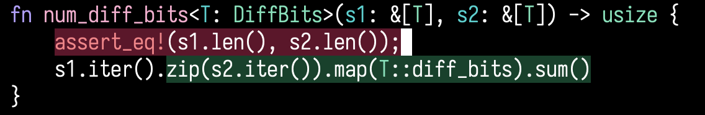

# rustc-inline-view.el

WIP

Get visual feedback of what rust code was successfully inlined (or
not) by the rust compiler in your project.



## Install

```elisp
(use-package rustc-inline-view
  :vc (:url rustc-inline-view "https://github.com/antichrome1/rustc-inline-view.el"))
```

## Usage

M-x `rustc-inline-view`

## Metadata

License: ISC<br>
AI usage: No AI agents/tools were/are used in this project.<br>
Contact: Aditya Singh <antichrome1@proton.me>
